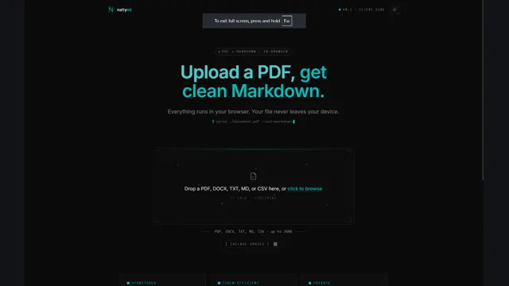
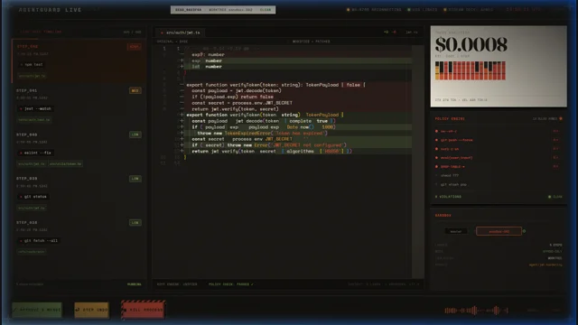
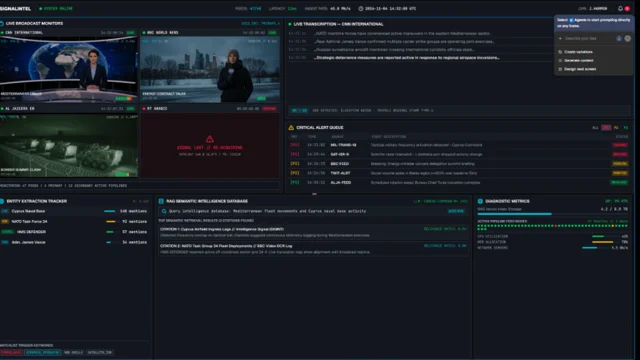
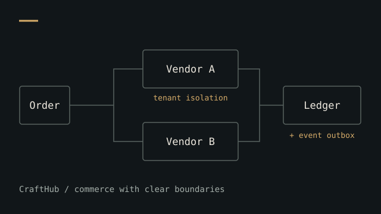

  <picture>
    <source media="(prefers-reduced-motion: reduce)" srcset="assets/creation-of-adam.webp">
    
  </picture>

<picture>
  <source media="(prefers-color-scheme: dark)" srcset="assets/masthead-dark.svg">
  
</picture>

**Full-stack & AI systems engineer · Addis Ababa, Ethiopia · UTC+3**

[Portfolio](https://natnaeltezazu.pro.et) &nbsp; / &nbsp; [LinkedIn](https://www.linkedin.com/in/natnael-tezazu) &nbsp; / &nbsp; [Email](mailto:natnaeltezazu01@gmail.com)

---

### A little about the builder

I’m Natnael, a software builder and technical co-founder based in Ethiopia. I turn difficult, unusual ideas into useful software—from enterprise operations and browser-based tools to AI runtimes and offline-first Android apps.

I care about what happens **after the demo**: when connectivity disappears, data gets messy, or a model suggests something it shouldn’t be allowed to do. My approach is simple: keep the architecture understandable, make important decisions predictable, and build in a way that can be checked.

### Selected work

<table>
  <tr>
    <td width="50%" valign="top">
      
      <h3><a href="https://github.com/Natnael-Dev/NatyMD-web">NatyMD</a></h3>
      
Documents into clean Markdown, inside your browser. Local OCR, editable output, and token analytics.

      
TypeScript · React · PDF.js · Tesseract

      
<a href="https://naty-md-web.vercel.app/">Try it live</a> · <a href="https://github.com/Natnael-Dev/NatyMD-web">Explore the code</a>

    </td>
    <td width="50%" valign="top">
      
      <h3><a href="https://github.com/Natnael-Dev/AgentHelm">AgentHelm</a></h3>
      
Mission control for AI coding agents. Isolated workspaces, shell-policy checks, and execution telemetry.

      
AI runtimes · Git worktrees · WebSockets

      
<a href="https://github.com/Natnael-Dev/AgentHelm">Explore the code</a>

    </td>
  </tr>
  <tr>
    <td width="50%" valign="top">
      
      <h3><a href="https://github.com/Natnael-Dev/SignalIntel">SignalIntel</a></h3>
      
Live broadcasts into searchable signals. Speech transcription, on-screen text, semantic search, and alerts.

      
Python · Rust · Whisper · Qdrant

      
<a href="https://github.com/Natnael-Dev/SignalIntel">Explore the code</a>

    </td>
    <td width="50%" valign="top">
      
      <h3><a href="https://github.com/Natnael-Dev/crafthub-marketplace">CraftHub</a></h3>
      
A multi-vendor marketplace built around tenant isolation, stock concurrency, financial ledgers, and reliable events.

      
Next.js · TypeScript · PostgreSQL · Drizzle

      
<a href="https://github.com/Natnael-Dev/crafthub-marketplace">Explore the code</a>

    </td>
  </tr>
</table>

**Also on the workbench:** [DailyRead](https://github.com/Natnael-Dev/dailyread), an offline-first Android reading-habit app for PDF and EPUB; [TeraGrant](https://github.com/Natnael-Dev/teragrant-agent), a grant-application assistant featured in my [portfolio](https://natnaeltezazu.pro.et/#systems).

### How I build

| The work | Tools & practices |
| :--- | :--- |
| **Interfaces people can use** | TypeScript, React, Next.js, Tailwind CSS |
| **Systems with clear boundaries** | Python, Node.js, Rust, APIs, WebSockets |
| **Data that stays consistent** | PostgreSQL, row-level security, SQLite, Redis |
| **AI with engineering around it** | Speech models, OCR, vector search, deterministic checks |
| **Software beyond a connection** | Kotlin, Compose, Flutter, local storage, synchronization |

### Beyond the repositories

I co-founded **Ethiosk**, a research-panel and survey project, and worked on the **Addis Mesob** enterprise operations platform. My portfolio brings together the architecture, case studies, and supporting evidence behind that work.

[Read the story & view the evidence](https://natnaeltezazu.pro.et/#about)

---

### Let’s build something useful.

Have a product, a difficult workflow, or an unusual idea in mind? [Send me a note](mailto:natnaeltezazu01@gmail.com).

[natnaeltezazu.pro.et](https://natnaeltezazu.pro.et) &nbsp; / &nbsp; [LinkedIn](https://www.linkedin.com/in/natnael-tezazu) &nbsp; / &nbsp; [GitHub](https://github.com/Natnael-Dev)

Built in Addis Ababa. Thinking beyond the demo.
