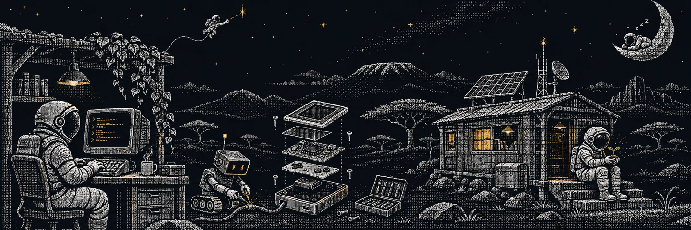
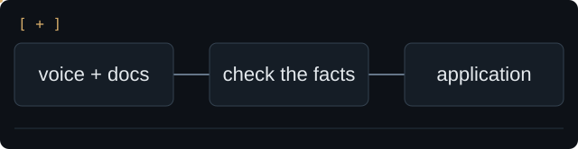
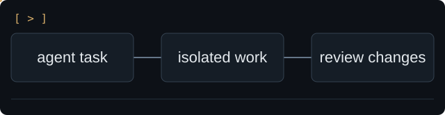
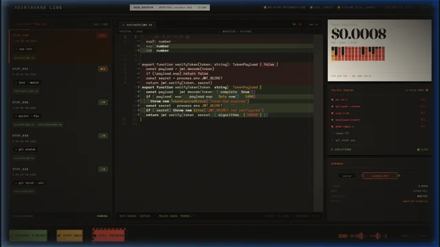
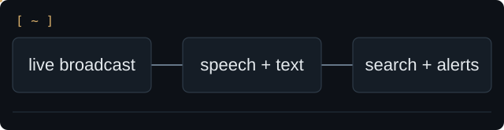
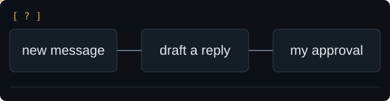

  <picture>
    <source media="(prefers-reduced-motion: reduce)" srcset="assets/creation-of-adam.webp">
    
  </picture>

<picture>
  <source media="(prefers-color-scheme: dark)" srcset="assets/masthead-dark.svg">
  
</picture>

**I build apps, tools, and AI systems. Based in Addis Ababa, Ethiopia.**

[Portfolio](https://natnaeltezazu.pro.et) &nbsp; / &nbsp; [LinkedIn](https://www.linkedin.com/in/natnael-tezazu) &nbsp; / &nbsp; [Email](mailto:natnaeltezazu01@gmail.com)

---

### hey, i’m natnael.

i make apps, tools, and whatever idea won’t leave my head. mostly web, mobile, and AI. still learning, usually building something.

<picture>
  <source media="(prefers-reduced-motion: reduce)" srcset="assets/workshop-world.webp">
  
</picture>

### A few things I’ve built

#### [TeraGrant](https://github.com/Natnael-Dev/teragrant-agent)

<picture>
  <source media="(prefers-reduced-motion: reduce)" srcset="assets/project-teragrant-still.svg">
  
</picture>

Helps small businesses turn voice notes and documents into grant applications. Keeps track of where facts came from and flags missing or conflicting details.

Python · FastAPI · Gemini · SQLite

[See the code](https://github.com/Natnael-Dev/teragrant-agent)

Take a look inside

---

#### [AgentHelm](https://github.com/Natnael-Dev/AgentHelm)

<picture>
  <source media="(prefers-reduced-motion: reduce)" srcset="assets/project-agenthelm-still.svg">
  
</picture>

A control room for AI coding agents. See what they’re doing, keep their work separate, and check commands before they run.

AI runtimes · Git worktrees · WebSockets

[See the code](https://github.com/Natnael-Dev/AgentHelm)

Take a look inside

---

#### [SignalIntel](https://github.com/Natnael-Dev/SignalIntel)

<picture>
  <source media="(prefers-reduced-motion: reduce)" srcset="assets/project-signalintel-still.svg">
  
</picture>

Follows live broadcasts, turns speech and on-screen text into searchable notes, and sends alerts when something matters.

Python · Rust · Whisper · Qdrant

[See the code](https://github.com/Natnael-Dev/SignalIntel)

Take a look inside

---

#### [GhostReply](https://github.com/Natnael-Dev/ghostreply)

<picture>
  <source media="(prefers-reduced-motion: reduce)" srcset="assets/project-ghostreply-still.svg">
  
</picture>

A personal reply agent for when messages pile up. Helps draft replies and holds anything uncertain for me to approve.

Python · FastAPI · Node.js · Human approval

[See the code](https://github.com/Natnael-Dev/ghostreply)

Pre-alpha · WhatsApp bridge working; Telegram in progress.

### What I work with

| What I’m making | What I reach for |
| :--- | :--- |
| **Web** · screens & interfaces | TypeScript / React / Next.js |
| **Systems** · tools & backends | Python / Node.js / Rust |
| **Data** · storage & sync | PostgreSQL / SQLite / Redis |
| **AI** · making sense of things | Speech / OCR / Vector search |
| **Mobile** · works offline too | Kotlin / Compose / Flutter |

### Outside these repos

I also co-founded **Ethiosk**, a research and survey project, and helped build software for **Addis Mesob**. There’s more about that work, and how I got here, on my portfolio.

[A bit more about me](https://natnaeltezazu.pro.et/#about)

---

<picture>
  <source media="(prefers-reduced-motion: reduce)" srcset="assets/astronaut.webp">
  
</picture>

### Let’s build something useful.

Got an idea, a project, or just want to say hi? [Send me a note](mailto:natnaeltezazu01@gmail.com).

[natnaeltezazu.pro.et](https://natnaeltezazu.pro.et) &nbsp; / &nbsp; [LinkedIn](https://www.linkedin.com/in/natnael-tezazu) &nbsp; / &nbsp; [GitHub](https://github.com/Natnael-Dev)

Made in Addis Ababa. Still learning. Still building.
