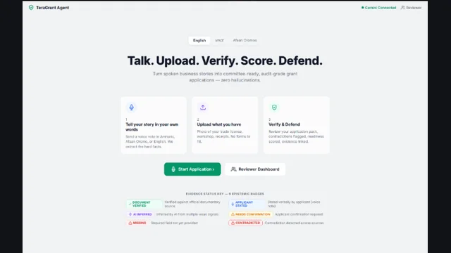
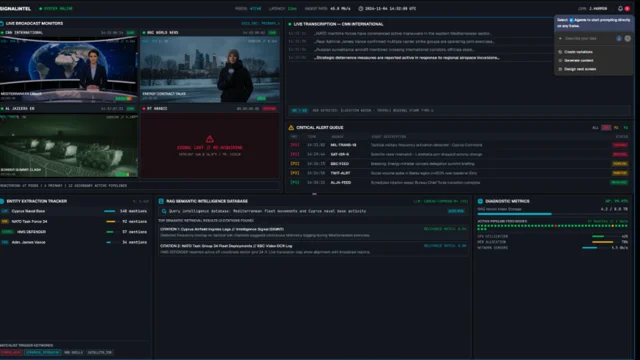
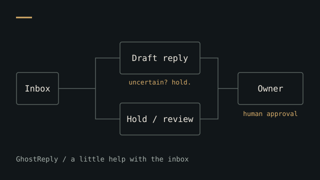

  <picture>
    <source media="(prefers-reduced-motion: reduce)" srcset="assets/creation-of-adam.webp">
    
  </picture>

<picture>
  <source media="(prefers-color-scheme: dark)" srcset="assets/masthead-dark.svg">
  
</picture>

**I build apps, tools, and AI systems. Based in Addis Ababa, Ethiopia.**

[Portfolio](https://natnaeltezazu.pro.et) &nbsp; / &nbsp; [LinkedIn](https://www.linkedin.com/in/natnael-tezazu) &nbsp; / &nbsp; [Email](mailto:natnaeltezazu01@gmail.com)

---

### Hey, I’m Natnael.

I like taking strange ideas and finding out if I can make them work. Sometimes that means an app. Sometimes it’s a tool that saves someone a few hours. Sometimes it turns into a much bigger project than I expected.

I work across web, mobile, and AI. I care about the boring parts too: keeping data safe, handling mistakes, and making sure things still work when the internet doesn’t.

### A few things I’ve built

<table>
  <tr>
    <td width="50%" valign="top">
      
      <h3><a href="https://github.com/Natnael-Dev/teragrant-agent">TeraGrant</a></h3>
      
Helps small businesses turn voice notes and documents into grant applications. Keeps track of where facts came from and flags missing or conflicting details.

      
Python · FastAPI · Gemini · SQLite audit trail

      
<a href="https://github.com/Natnael-Dev/teragrant-agent">See how it works</a>

    </td>
    <td width="50%" valign="top">
      
      <h3><a href="https://github.com/Natnael-Dev/AgentHelm">AgentHelm</a></h3>
      
A control room for AI coding agents. See what they’re doing, keep their work separate, and check commands before they run.

      
AI runtimes · Git worktrees · WebSockets

      
<a href="https://github.com/Natnael-Dev/AgentHelm">See the code</a>

    </td>
  </tr>
  <tr>
    <td width="50%" valign="top">
      
      <h3><a href="https://github.com/Natnael-Dev/SignalIntel">SignalIntel</a></h3>
      
Follows live broadcasts, turns speech and on-screen text into searchable notes, and sends alerts when something matters.

      
Python · Rust · Whisper · Qdrant

      
<a href="https://github.com/Natnael-Dev/SignalIntel">See the code</a>

    </td>
    <td width="50%" valign="top">
      
      <h3><a href="https://github.com/Natnael-Dev/ghostreply">GhostReply</a></h3>
      
A personal reply agent for when messages pile up. Helps draft replies and holds anything uncertain for me to approve.

      
Python · FastAPI · Node.js · Human approval

      
Pre-alpha · WhatsApp bridge working; Telegram in progress.

      
<a href="https://github.com/Natnael-Dev/ghostreply">See the code</a>

    </td>
  </tr>
</table>

### What I work with

| For | My usual tools |
| :--- | :--- |
| Web apps | TypeScript, React, Next.js, Tailwind CSS |
| Backends & tools | Python, Node.js, Rust |
| Data | PostgreSQL, SQLite, Redis |
| AI projects | Speech models, OCR, vector search |
| Mobile & offline apps | Kotlin, Compose, Flutter |

### Outside these repos

I also co-founded **Ethiosk**, a research and survey project, and helped build software for **Addis Mesob**. There’s more about that work, and how I got here, on my portfolio.

[A bit more about me](https://natnaeltezazu.pro.et/#about)

---

### Let’s build something useful.

Got an idea, a project, or just want to say hi? [Send me a note](mailto:natnaeltezazu01@gmail.com).

[natnaeltezazu.pro.et](https://natnaeltezazu.pro.et) &nbsp; / &nbsp; [LinkedIn](https://www.linkedin.com/in/natnael-tezazu) &nbsp; / &nbsp; [GitHub](https://github.com/Natnael-Dev)

Made in Addis Ababa. Still learning. Still building.
